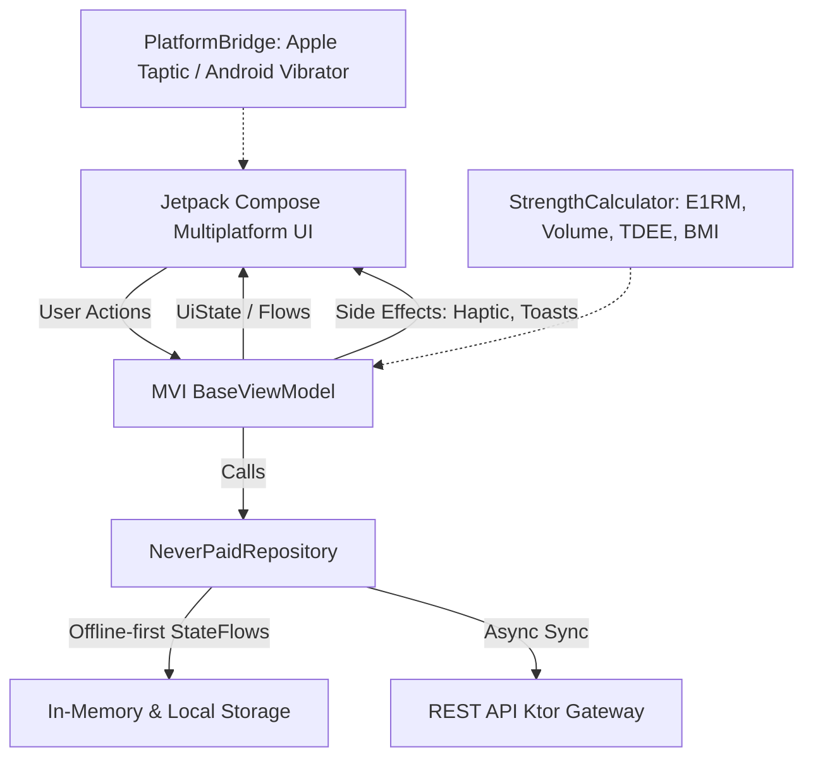

# 🏋️‍♂️ NeverPaidHealth Mobile (Compose Multiplatform — Android & iOS)

[](https://github.com/Ferchke7/NeverPaidHealth-Mobile/releases/latest)
[](https://github.com/Ferchke7/NeverPaidHealth-Mobile/actions)
[-3DDC84?logo=android&logoColor=white)](https://github.com/Ferchke7/NeverPaidHealth-Mobile)
[](https://www.jetbrains.com/lp/compose-multiplatform/)
[](LICENSE)

> **Высокопроизводительное кроссплатформенное мобильное приложение для силовых тренировок и аналитики здоровья (Android & Apple iOS).**  
> 100% общий Kotlin код (MVI, UI, математика E1RM, offline-хранилище), 120 FPS анимации, мгновенный старт без интернета (0 мс задержки), поддержка тактильной отдачи (Apple Taptic Engine и Android Vibrator) и автоматическая сборка установочных APK через GitHub Actions.

---

## 📲 Быстрое скачивание (1 клик)

### 🤖 Для Android:
Вы можете сразу скачать готовый установочный `.apk` файл на свой смартфон:

* 📥 **[Скачать NeverPaidHealth-v1.0.0-debug.apk (Прямая ссылка)](https://github.com/Ferchke7/NeverPaidHealth-Mobile/releases/download/v1.0.0/NeverPaidHealth-v1.0.0-debug.apk)**
* 📦 **[Страница всех релизов GitHub Releases](https://github.com/Ferchke7/NeverPaidHealth-Mobile/releases)**
* ⚡ **[Свежие ночные сборки из GitHub Actions Artifacts](https://github.com/Ferchke7/NeverPaidHealth-Mobile/actions/runs/40205982968)** (вкладка *Artifacts* $\rightarrow$ `NeverPaidHealth-Android-APK`)

---

## 🛠️ Инструкция по установке

### 1. Установка APK на Android-смартфон
1. Нажмите на **[ссылку для скачивания APK](https://github.com/Ferchke7/NeverPaidHealth-Mobile/releases/download/v1.0.0/NeverPaidHealth-v1.0.0-debug.apk)** в браузере телефона (Chrome, Samsung Internet, Яндекс и т.д.).
2. После завершения загрузки нажмите **Открыть** (или перейдите в папку *Загрузки / Downloads*).
3. Если Android покажет предупреждение системы безопасности:
   - Нажмите **Настройки** $\rightarrow$ включите переключатель **«Разрешить установку из этого источника»**.
   - Вернитесь назад и нажмите **Установить**.
4. Готово! Приложение появится на рабочем столе и готово к работе полностью автономно.

> **Для разработчиков через ADB**:
> ```bash
> adb install -r NeverPaidHealth-v1.0.0-debug.apk
> ```

---

### 2. Запуск на Apple iOS (iPhone / iPad / Симулятор)
Приложение построено на **Compose Multiplatform**, где UI и логика компилируются в нативный Apple Mach-O Framework (`ComposeApp.framework`):

1. **Системные требования**: Mac с macOS Sonoma/Sequoia, установленный Xcode 15+ и JDK 21.
2. Клонируйте репозиторий:
   ```bash
   git clone https://github.com/Ferchke7/NeverPaidHealth-Mobile.git
   cd NeverPaidHealth-Mobile
   ```
3. Соберите iOS-фреймворк для симулятора или физического устройства:
   ```bash
   # Для симулятора Apple Silicon (M1/M2/M3/M4):
   ./gradlew :composeApp:linkDebugFrameworkIosSimulatorArm64
   ```
4. Откройте проект iOS в Xcode:
   ```bash
   open iosApp/iosApp.xcodeproj
   ```
5. В Xcode выберите схему **iosApp** и целевое устройство (любой iPhone симулятор или подключённый iPhone) и нажмите **Run (Cmd + R)**.

---

## 🚀 Основные возможности приложения

### 1. 🏋️‍♂️ Интерактивный трекер тренировок (стиль Hevy / Strong)
* **Динамические типы сетов**: Обычный (1, 2, 3), Разминочный (**W**), Дроп-сет (**D**), До отказа (**F**).
* **Призрачные подсказки (Ghost-values)**: отображение веса и повторений из прошлой тренировки для наглядной прогрессии.
* **1-тап завершение подхода**: клик на чекбокс подсвечивает подход изумрудным неоном и даёт чёткую тактильную отдачу (Haptic feedback).
* **Умный плавающий таймер отдыха**:
  - Автоматический запуск при завершении подхода (по умолчанию 90 сек, настраивается).
  - Быстрые кнопки: `+30s`, `-15s`, `Skip`.
  - Звуковое и вибро-оповещение по окончании отдыха.
* **Калькулятор 1RM в реальном времени**: расчёт одноповторного максимума (E1RM) по формуле Эпли / Бризики на лету.
* **Подсчёт тоннажа**: мгновенное обновление общего объёма тренировки (кг) и времени под нагрузкой.
* **Праздничный экран итогов**: детальный отчет по объёму, времени, сетам и новым рекордам (PR).

### 2. 📚 Каталог упражнений (870+ движений)
* Мгновенный поиск с фильтрацией по мышечным группам (**Грудь, Спина, Квадрицепсы, Бицепс бедра, Плечи, Бицепс, Трицепс, Пресс/Кор**).
* Фильтры по инвентарю: **Штанга, Гантели, Блоки (тросы), Тренажеры, Собственный вес**.
* Карточка упражнения с пошаговой инструкцией по биомеханике и списком вторичных мышц-синергистов.

### 3. 📅 История и тепловая карта тренировок (Training Heatmap)
* Годовая матрица плотности тренировок в стиле **GitHub Contribution Heatmap** с градацией интенсивности.
* Хронологическая лента прошедших сессий с полной детализацией каждого подхода.

### 4. 📈 Аналитика гипертрофии и Зал Славы PR
* Недельные графики суммарного тоннажа (Volume Progression).
* Распределение подходов по мышечным группам с учётом ориентиров **MEV** (Minimum Effective Volume) и **MRV** (Maximum Recoverable Volume).
* **Зал Славы рекордов**: отслеживание персональных рекордов (PR) в жиме, приседе, тяге и изоляции.

### 5. 🤖 Спортивный AI-тренер (AI Strength Coach)
* **Индекс готовности ЦНС (CNS Readiness Score 0–100)**: оценка восстановления организма ("Full Throttle" / "Moderate" / "Deload").
* Автоматические рекомендации прогрессивной перегрузки (например, `+2.5 кг на следующей тренировке`).
* Интерактивный научно-обоснованный чат со спортивным AI-наставником.

### 6. ⚖️ Мониторинг веса и состава тела
* Дневник взвешиваний со **скользящим средним за 7 дней** (сглаживает колебания водного баланса).
* Авторасчёт ИМТ (BMI), процента жира и суточного расхода калорий (**TDEE по формуле Миффлина — Сан Жеора**).

### 7. ⚙️ Индивидуальные настройки атлета
* Мгновенный переключатель единиц измерения: **КГ (кг) $\leftrightarrow$ ФУНТЫ (lbs)**.
* Настройка времени отдыха по умолчанию (60с, 90с, 120с, 180с).
* Переключатели звуковых сигналов и виброотклика.
* Возможность подключения к собственному бэкенду REST API Gateway (поддержка Android Emulator `10.0.2.2:8080` и внешнего сервера).

---

## 🎨 Дизайн-система: Athletic OLED Dark

Интерфейс спроектирован по канонам премиальных спортивных фитнес-приложений:
* **Background**: Глубокий энергосберегающий чёрный OLED (`#0B0E14`)
* **Surfaces**: Карточки тёмного графита (`#151921` и `#1F2430`)
* **Neon Accent**: Изумрудный спортивный неоновый акцент (`#10B981`)
* **Text High-Contrast**: Чистый белый `#FFFFFF` и контрастный серебристый `#94A3B8`
* **Typography**: Современный спортивный гротеск с моноширинными цифрами для весов и таймеров

---

## 🏗️ Архитектура и стек технологий

Приложение разработано строго по рекомендациям официального **Compose Kit / compose-skill**:



* **UI Layer**: Compose Multiplatform (Material 3)
* **Архитектурный паттерн**: MVI (`UiAction`, `UiState`, `UiEffect`) с `BaseViewModel` и `launchGuarded`
* **Dependency Injection**: Koin Multiplatform (`koinViewModel`)
* **Multiplatform Навигация**: Compose State Navigation с плавной сменой экранов и адаптивным BottomBar
* **Platform Bridge**: `expect` / `actual` для тактильного отклика:
  - iOS: `UIImpactFeedbackGenerator`
  - Android: `Vibrator` / `VibratorManager`
* **Математическое ядро**:
  - `StrengthCalculator.calculateE1RM` (Epley formula: $w \cdot (1 + \frac{r}{30})$)
  - `StrengthCalculator.calculateVolume`
  - `StrengthCalculator.calculate7DayMovingAverage`
  - `StrengthCalculator.calculateBMI` & `calculateTDEE`

---

## 🤖 GitHub Actions CI/CD Pipeline

В репозитории настроен автоматический конвейер непрерывной интеграции и доставки:
[`.github/workflows/build-and-release.yml`](.github/workflows/build-and-release.yml)

При каждом `git push` в ветку `main` или отправке тега `v*.*.*`:
1. **Runner `ubuntu-latest` (Android)**:
   - Разворачивает JDK 21 (Temurin).
   - Запускает весь набор юнит-тестов (`:composeApp:testDebugUnitTest`).
   - Компилирует APK (`:composeApp:assembleDebug`).
   - Загружает файл в **GitHub Actions Artifacts**.
   - Автоматически создает/обновляет **GitHub Release** и прикрепляет файл `NeverPaidHealth-v1.0.0-debug.apk` для свободного публичного скачивания.
2. **Runner `macos-latest` (Apple iOS)**:
   - Проверяет целостность сборки нативного iOS-фреймворка (`:composeApp:linkDebugFrameworkIosSimulatorArm64`).

---

## 💻 Сборка из исходного кода (для разработчиков)

### Предварительные требования
* JDK 21+
* Android Studio Ladybug / Meerkat или IntelliJ IDEA / JetBrains Fleet
* Android SDK 35 (Platform + Build-Tools)

### Запуск Android Debug сборки
```bash
# Запустить юнит-тесты
./gradlew :composeApp:testDebugUnitTest

# Собрать APK
./gradlew :composeApp:assembleDebug

# Готовый APK появится по пути:
# composeApp/build/outputs/apk/debug/composeApp-debug.apk
```

### Запуск iOS сборки на macOS
```bash
./gradlew :composeApp:linkDebugFrameworkIosSimulatorArm64
```

---

## 📄 Лицензия

Проект распространяется под свободной лицензией **MIT License**. Свободно для использования, модификации и дистрибуции.
